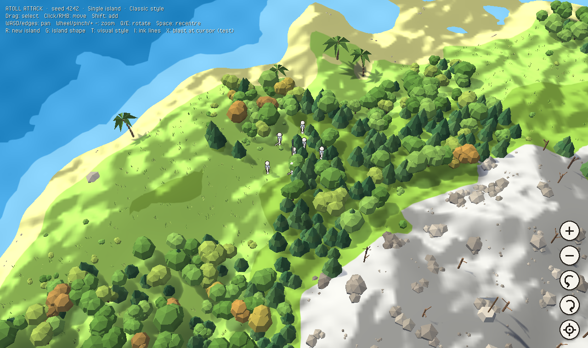

# Atoll Attack — Heaps spike

A Haxe/[Heaps](https://heaps.io) port spike of [atoll-attack](https://github.com/mrisney/atoll-attack): a stylized, low-poly procedural atoll with two squads you can box-select and move.

| Classic style (ported from the Flutter game) | Ink map style |
|---|---|
|  |  |


The goal of this spike is to answer one question: does Heaps give the Northgard-style look and a pleasant dev loop? It covers:

- **Two island shapes** (G to switch): *Single*, a direct port of the Flutter game's `island_water.frag` generator (fbm + three seeded peaks + radial falloff, same default amplitude/wavelength/bias/radius), and *Atoll*, a reef ring around a lagoon.
- **Two visual styles** (T to switch): *Classic* carries over the Flutter look, with hard posterised bands (sand, lowland, upland, peak), the stepped three-tone water and the crinkly relief highlight (baked to a texture per island so it's cheap on phones). *Ink map* adds soft colours, contours, hatching and ink outlines.
- **Procedural atoll**: a seeded, deterministic heightfield (Int32 hashing, so every platform generates the same island) with a wobbly reef ring broken into islets, a shallow lagoon, and a raised apex where the flag stands.
- **Units**: Captain, Swordsmen, and Archers for blue and red, built from low-poly primitives.
- **RTS controls**: box select, click or right-click to move with formation spreading, shift to add to the selection, slope-aware movement, and units that stop at the shoreline.
- **Camera**: on-screen buttons (bottom right) for zoom in/out, rotate, and re-centre on your squad. Tap for a step, or hold to keep going. Also mouse wheel or trackpad pinch to zoom, two-finger pan/pinch on touch, WASD/arrows/screen edges to pan, Q/E to rotate, +/- to zoom, and Space to re-centre.
- **Ink rendering**: a screen-space edge pass that inks every silhouette at a constant line weight, plus topo-map contour lines, a bold coastline and slope hatching painted on the terrain. Press I to toggle the ink pass.
- **Line-art units**: rounded, faceless figures with a paper-white fill and a restrained walk cycle.
- **Sun shadows**: soft, cool-tinted directional shadows from trees, rocks, units and hills onto terrain and water.
- **Prop variety**: palms leaning toward the sea, mixed broadleaf and pine woods with the odd turning tree, bushes, grass meadows, rock outcrops, driftwood, loose stones and dead snags on the heights. Placed by elevation band and clustered by noise, with a colour and size per instance, merged into a handful of draw calls.
- **Rag dolls**: when a unit dies it's flung away from the hit and tumbles into a Verlet rag doll that collides with the terrain, floats at the water surface, and settles. Press **X** to blast units near the cursor (a test key until combat exists).

## Architecture

```
src/
  Main.hx                   app wiring, R = new island
  world/Noise.hx            seeded value noise / fbm (deterministic)
  world/Island.hx           heightfield, heightAt(), walkability, apex
  game/Unit.hx              sim-side unit (no rendering)
  game/Command.hx           Move / Stop / Kill — what you'd send over the network
  game/Sim.hx               fixed 30 Hz tick, applies queued commands
  render/Palette.hx         the whole art direction in one file
  render/FlatMeshBuilder.hx low-poly faceted geometry helper
  render/IslandView.hx      terrain, water, apex flag; shadow setup per mesh
  render/Props.hx           vegetation and rocks: species, biome placement, clustering
  render/WaterShader.hx     banded water from a heightmap texture + swell/shimmer
  render/TerrainStyle.hx    Classic bands + baked relief, or soft vertex colours
  render/InkShape.hx        rounded line-art shapes for units
  render/ink/InkRenderer.hx geometry pass + screen-space ink composite
  render/ink/InkEdge.hx     edge detection (normals + inverse-depth Laplacian)
  render/ink/TerrainInk.hx  contours, coastline, slope hatching
  render/ink/GeoOut.hx      per-material normal/depth output
  render/UnitView.hx        unit figures, selection rings, interpolation, rag doll hookup
  render/Ragdoll.hx         Verlet rag doll (11 particles, terrain collision, sleeps when settled)
  input/RtsCamera.hx        orbit/pan/zoom camera
  input/SelectionController.hx  pointer/touch → selection + Commands
  ui/ControlBar.hx          on-screen camera buttons (touch-sized)
```

The simulation (`world/`, `game/`) never touches rendering or input. Input produces `Command`s, and the `Sim` consumes them on fixed ticks. That is the shape you need for lockstep multiplayer (Steam P2P or WebRTC) and for porting the rules from the Flutter version.

## Setup

1. Install [Haxe 4.3+](https://haxe.org/download/) and [HashLink](https://hashlink.haxe.org/).
2. Install the libraries:
   ```sh
   haxelib install heaps
   haxelib install hlsdl
   ```
   For the latest Heaps instead of the release, run `haxelib git heaps https://github.com/HeapsIO/heaps.git`.

## Run

**Desktop (HashLink):**
```sh
haxe build-hl.hxml
hl bin/game.hl
```

**Web (WebGL):**
```sh
haxe build-js.hxml
npx http-server bin    # or any static server
```
Then open http://localhost:8080.

## Running on a Mac

### Quickest: the web build (works on any Mac)

```sh
brew install haxe
haxelib setup ~/haxelib          # once; pick any folder
haxelib install heaps
./scripts/run-web.sh             # builds, serves on :8080, opens the browser
```

After editing code, run `haxe build-js.hxml` and refresh the page. That's the everyday dev loop.

### Native app (Apple Silicon)

The HashLink VM's JIT is x86-only for now, so `hl bin/game.hl` won't run natively on M-series Macs. Instead, use **HashLink/C**, which compiles to C and builds a real arm64 executable. Shiro uses the same path for consoles.

```sh
brew install hashlink sdl2
haxelib install hlsdl
./scripts/build-mac-native.sh
./bin/atoll
```

On an Intel Mac, `haxe build-hl.hxml && hl bin/game.hl` also works and compiles faster.

### Editor

Use VS Code with the **Haxe** extension (vshaxe) for completion and go-to-definition. Point it at `build-js.hxml`.

## Snapshots (for you or an agent)

```sh
npm install && npx playwright install chromium     # once
node scripts/snapshot.mjs                           # → snapshots/single-classic-4242.png
node scripts/snapshot.mjs --style=inkmap --shape=atoll --seed=777 --walk
```

This builds the web version, runs it headless, and saves screenshots. It exits non-zero if the page errors, so it doubles as a smoke test. See `CLAUDE.md` for project rules and known Heaps gotchas.

## Testing on mobile

- **Fastest:** use Chrome DevTools device mode on the web build.
- **Android emulator:** open Chrome in the emulator and go to `http://10.0.2.2:8080`.
- **iOS Simulator:** open Safari and go to `http://localhost:8080`.
- **Real phone on the same Wi-Fi:** the only way to really test pinch and multi-touch.

## Roadmap ideas

- Ships and landings, ported from the Flutter `ShipComponent`
- Port `CombatRules` and add the flag-capture win condition at the apex
- Seasons/weather shader pass, plus shadows (`h3d.pass.DefaultShadowMap`)
- Steamworks via `hlsteam`, with Steam lobbies replacing room codes on PC
- A mobile wrapper (Capacitor) around the WebGL build

## License

MIT
