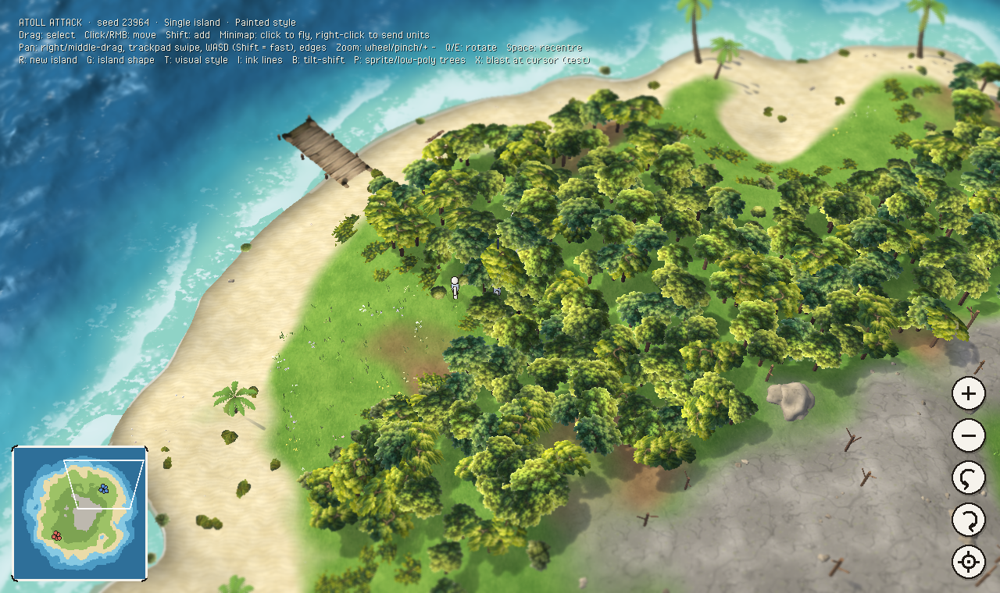
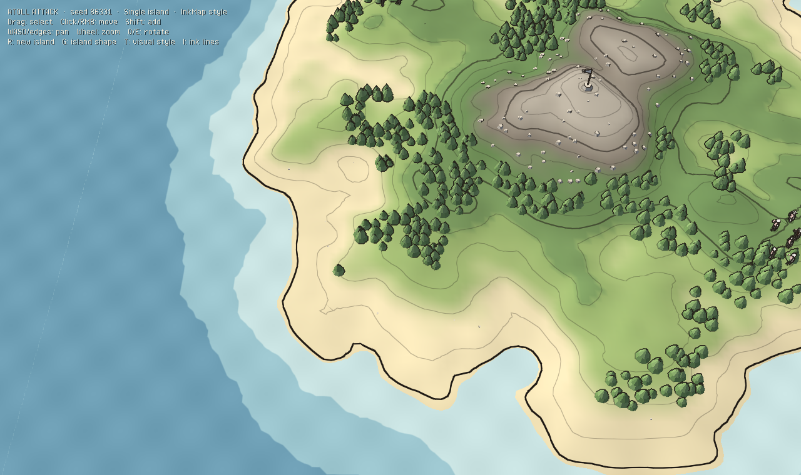
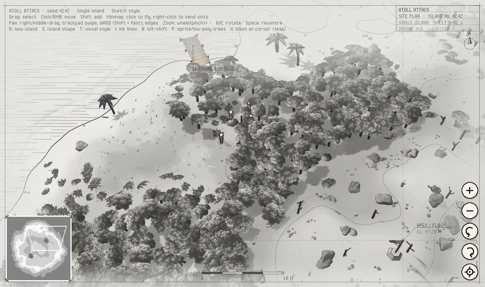
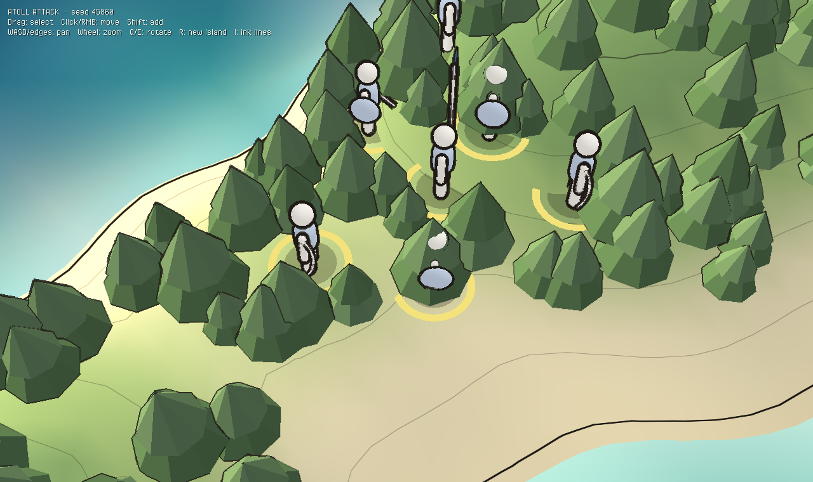
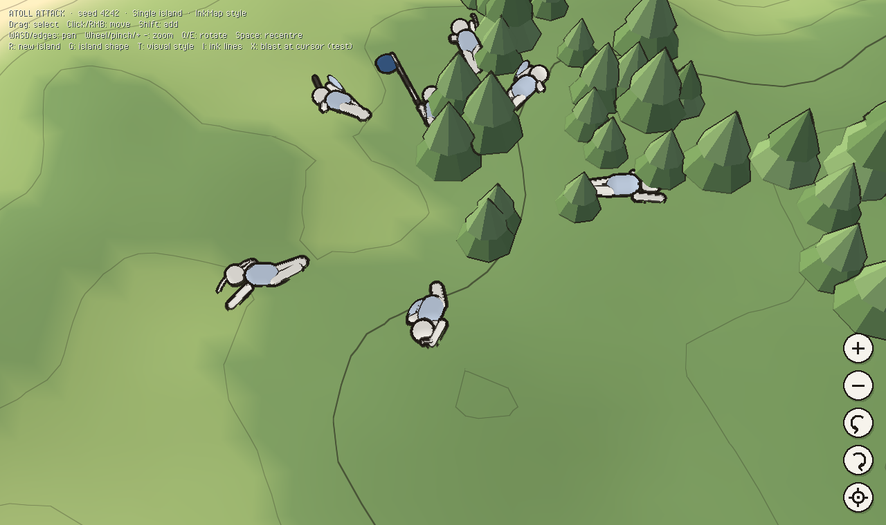

# Atoll Attack — Heaps spike

A Haxe/[Heaps](https://heaps.io) port spike of [atoll-attack](https://github.com/mrisney/atoll-attack): a stylized, low-poly procedural atoll with two squads you can box-select and move.

| Painted (default) | Ink map |
|---|---|
|  |  |







The goal of this spike is to answer one question: does Heaps give the Northgard-style look and a pleasant dev loop? It covers:

- **Two island shapes** (G to switch): *Single*, a direct port of the Flutter game's `island_water.frag` generator (fbm + three seeded peaks + radial falloff, same default amplitude/wavelength/bias/radius), and *Atoll*, a reef ring around a lagoon.
- **Three visual styles** (T cycles them):
  - *Painted* (the default) blends painted grass, dirt, rock and sand textures (generated in code, no assets), with wandering patch edges, wet sand at the waterline, soft turquoise water, and a tilt-shift blur for a miniature-diorama feel.
  - *Ink map* is the same world as Painted without its colour grade, blur and vignette (the brighter scene), with soft ink outlines.
  - *Sketch* is an architectural presentation drawing. Nature is in muted earth tones (sage, olive, warm stone, slate water) on paper, with real sun shading on the terrain instead of contour lines. Timber (docks, the flag pole) keeps its full colour. The water is a dark, muted slate-teal with the same waves and froth as Painted, the frame dissolves into the page at the top and margins, and a drafting layer adds a title block, scale bar, north arrow, a datum through the apex, landing labels, and move orders drawn as dimension lines in metres.
- **Procedural atoll**: a seeded, deterministic heightfield (Int32 hashing, so every platform generates the same island) with a wobbly reef ring broken into islets, a shallow lagoon, and a raised apex where the flag stands.
- **Units**: Captain, Swordsmen, and Archers for blue and red, built from low-poly primitives.
- **RTS controls**: box select, click or right-click to move with formation spreading, shift to add to the selection, slope-aware movement, and units that stop at the shoreline.
- **Camera** (smoothly eased, with direct manipulation where it matters):
  - *Pan*: right- or middle-drag to grab the map (a right-click without dragging is still a move order); two-finger swipe on a Mac trackpad; WASD/arrows (hold Shift for faster); screen edges; one-finger drag on touch.
  - *Zoom*: mouse wheel, trackpad pinch, two-finger pinch on touch, +/-, or the on-screen buttons.
  - *Rotate*: Q/E or the on-screen buttons. *Re-centre*: Space or the target button.
  - *Minimap* (bottom left): click or drag to fly there, right-click to send the selected units. It shows your view and both squads.
  - Touch box-select: press and hold, then drag.
- **Ink rendering**: a screen-space edge pass that inks every silhouette at a constant line weight (Ink map and Sketch). Press I to toggle it. (The old contour lines, inked coastline and slope hatching were retired.)
- **Line-art units**: rounded, faceless figures with a paper-white fill and a restrained walk cycle.
- **Sun shadows**: soft, cool-tinted directional shadows from trees, rocks, units and hills onto terrain and water.
- **3D procedural trees** (default): oak, ash, aspen and pine grown by a Haxe port of [EZ-Tree](https://github.com/dgreenheck/ez-tree) (MIT; see THIRD_PARTY.md): recursive branches with taper, gnarl and twist, crossed leaf cards with a sprig texture painted in code, rounded crown shading, sway and leafy shadows. P cycles 3D / sprite / low-poly trees.
- **Sprite trees** (P): painted top-down canopies and bushes from the WildCurrent asset bank, mapped onto shallow domes with alpha-cut silhouettes that cast leaf-shaped shadows. Reeds and cattails stand in the shallows.
- **Coast** (from WildCurrent's art): a wooden dock with pilings at each landing beach, and floating-log driftwood.
- **More foliage**: weeping vine-draped canopies (commoner near water), tall dune grass on the beaches. All foliage sways subtly in the breeze, shadows included.
- **3D rocks**: boulders and loose stones are procedural meshes (a noise-deformed icosphere with fracture planes, sunk into the ground, darkened at the base, with the painted rock texture projected from three sides) lit by the scene's sun, so they agree with the light and cast real shadows.
- **Wind waves**: an FFT ocean (Tessendorf's method, Phillips spectrum) baked once at startup into a seamless looping texture, so on the GPU it's just texture lookups. The water is lit by the waves (light and shade, sun glints, lighter crests). Foam comes from the simulation itself (where crests fold over), lingering in patches: sparse whitecaps at sea, and in the shallows the swell breaks into froth that rolls in along the depth contours and runs up the sand as swash, leaving it wet. Only shores exposed to the open swell break; lagoons stay calm.
- **Blast craters**: scorched pits with thrown soil, draped over the terrain where X blasts land.
- **Pastoral island with grass fields in the wind**: broad open fields divided by winding tree lines, with small copses and lone trees. The grass is a fixed budget of real blades around the view (100k blades out to 85 m by default, `?blades=` / `?depth=`, like terra's settings), wrapped onto a world grid so it never slides, placed on the ground and shaped by a field map in the vertex shader,, bent by rolling gusts and lit as translucent leaves. Inspired by spacejack/terra; own implementation.
- **Grass parts as units walk through it**: a trample map stamped by every unit bends blades outward from their feet, leaving trails that spring back over a few seconds. Tree canopies open up over figures walking beneath them.
- **Micro-scatter**: wildflowers in the meadows, shells on the beaches, loose pebbles in the uplands.
- **Tilt-shift** (B to toggle; on by default in Painted).
- **Ships and landings**: each side's crew (14 characters) starts aboard its ship. Click your ship, then click a stretch of coast: it sails round through deep water, anchors, and the crew wades ashore. Click open water to just sail; it finds its way round the island. With characters selected, click your ship to send them back aboard: they heal there and land again with the ship's next landing order (Esc clears the selection so you can select the ship itself).
- **Cannons**: each ship fires by itself from its broadsides at enemy characters ashore (where they bunch up) and at the enemy ship, lobbing balls that land where they were aimed: the further the target, the wider they scatter, and nothing beyond 40 m. A ship that takes too many hits sinks with everyone aboard.
- **Combat**: swordsmen, pikers and the captain fight hand to hand; archers shoot arrows from range and back away from blades. Every character has a little mind of its own: it holds where you left it, takes on enemies that come near, chases them a little way and hits back when hit. Your orders come first: right-click ground to move (ignoring enemies on the way), right-click an enemy to attack it. Fallen characters drop as rag dolls.
- **The march**: once everyone is ashore, the band sets off for the summit as a flock (boids: separation, alignment, cohesion, plus a path round water), with the captain trailing at the rear. They fight whatever they meet and fall back in. Give any unit an order and it leaves the march. Tune it in the `"march"` section of `res/data/directives.json`.
- **The captain is protected**: he lands last and stays at the back. Every soldier's first duty is to guard him, so they go for any enemy that comes near him or aims at him, and he pulls back from danger unless you order him forward. What every character does, and all the game's numbers, are in `res/data/directives.json`.
- **Capture the flag**: a captain who stands at the summit for five seconds, with no enemy close, plants his flag. It then has to fly for 60 seconds to win, with a countdown over the summit and at the top of the screen. Meanwhile the enemy captain can fight his way up and lower it (five seconds), which resets the clock. Every timing is in `res/data/directives.json`. Losing your captain, or your whole crew, loses. The red side is a computer commander that lands, advances on the summit and sends its captain up once it holds it.
- **Weather**: sunny, fog, or rain/storm (rain streaks, rougher sea, darker sky, drifting fog). Each style starts in one; **C** cycles, `?weather=sunny|fog|rain`.
- **Antialiasing**: 4x MSAA, plus FXAA when tilt-shift renders offscreen (`?aa=0` turns FXAA off).
- **Prop variety**: palms leaning toward the sea, mixed broadleaf and pine woods with the odd turning tree, bushes, grass meadows, rock outcrops, driftwood, loose stones and dead snags on the heights. Placed by elevation band and clustered by noise, with a colour and size per instance, merged into a handful of draw calls.
- **Rag dolls**: when a unit dies it's flung away from the hit and tumbles into a Verlet rag doll that collides with the terrain, floats at the water surface, and settles. Press **X** to blast units near the cursor (a test key until combat exists).

## Architecture

```
src/
  Main.hx                   app wiring, R = new island
  world/Noise.hx            seeded value noise / fbm (deterministic)
  world/Island.hx           heightfield, heightAt(), walkability, apex
  game/Unit.hx              sim-side unit (no rendering)
  game/Command.hx           Move / Stop / Kill — what you'd send over the network
  game/Sim.hx               fixed 30 Hz tick, applies queued commands
  render/Palette.hx         the whole art direction in one file
  render/FlatMeshBuilder.hx low-poly faceted geometry helper
  render/IslandView.hx      terrain, water, apex flag; shadow setup per mesh
  render/Props.hx           vegetation and rocks: species, biome placement, clustering
  render/GrassField.hx      wind-blown grass fields: blade strips bent and lit in a vertex shader
  render/TreeGen.hx         procedural tree skeleton + mesh (port of EZ-Tree, MIT)
  render/ProcTrees.hx       tree species presets, templates, instancing, leaf/bark textures
  render/Trample.hx         trample map (grass parting, trails) + canopy see-through over units
  render/Palms.hx           coconut palms: curved smooth trunks, arched leafy fronds (texture painted in code)
  render/SpriteProps.hx     painted sprites on alpha-tested domes (one draw call per sprite)
  render/Rocks.hx           procedural 3D boulders and stones (triplanar painted texture)
  render/SketchTone.hx      Sketch style: greys everything but timber, with paper grain
  render/SwayShader.hx      subtle foliage sway (vertices ripple, the tree doesn't swing)
  render/Surf.hx            animated breaking waves along the coast (one draw call)
  render/Decals.hx          terrain-draped decals (blast craters)
res/                        art from WildCurrent (embedded into the build; see res/SOURCE.md)
  render/WaterShader.hx     banded water from a heightmap texture, lit by the baked wind waves
  render/OceanWaves.hx      CPU FFT ocean baked into a looping wave atlas (slopes + height)
  render/TerrainStyle.hx    Painted texture blend or soft vertex colours, sun shading, beach swash
  render/GroundTextures.hx  painted, tileable grass/dirt/sand/rock textures generated at startup
  render/InkShape.hx        rounded line-art shapes for units
  render/ink/InkRenderer.hx geometry pass + screen-space ink composite
  render/ink/InkEdge.hx     edge detection (normals + inverse-depth Laplacian)
  render/ink/GeoOut.hx      per-material normal/depth output
  render/ink/TiltShift.hx   miniature-style blur toward the top and bottom of the frame
  render/UnitView.hx        unit figures, selection rings, interpolation, rag doll hookup
  render/ShipView.hx        the ships: timber hull, team sail, bobbing on the swell
  game/Ship.hx              ships: deep-water sailing, anchoring, crew landing (sim side)
  game/Cannonball.hx        a cannonball in flight, and where one came down
  render/CannonView.hx      cannonballs, powder smoke, spray, dust and craters
  game/Rules.hx             damage, type advantages, target choice (numbers from res/data/directives.json)
  game/Directives.hx        loads res/data/directives.json: every stat, range and duty
  game/TeamAI.hx            the computer commander (red)
  game/Arrow.hx             arrows in flight (sim side); render/ArrowsView.hx draws them
  world/NavGrid.hx          A* walking paths round water
  ui/BattleOverlay.hx       health bars, flag raising/lowering bar, countdown ring, win banner
  render/FlagView.hx        the summit flag: team cloth climbing and sliding on the pole
  render/CharacterModel.hx  rigged FBX character (opt-in ?figures=rigged): props on joints, takes, rag doll on the skeleton
  render/CharacterInk.hx    pencil hatching + inverted-hull outline for the rigged characters
  render/Tracks.hx          worn tracks and scuffed ground (thins grass, dusty earth)
  render/CloudShadow.hx     drifting cloud shadows (Painted)
  render/Ragdoll.hx         Verlet rag doll (11 particles, terrain collision, sleeps when settled)
  input/RtsCamera.hx        orbit/pan/zoom camera
  input/SelectionController.hx  pointer/touch → selection + Commands
  ui/ControlBar.hx          on-screen camera buttons (touch-sized, Retina-scaled)
  ui/DraftingOverlay.hx     Sketch style's drafting layer (title block, scale bar, dimension lines)
  ui/Minimap.hx             click-to-fly minimap with view outline and unit dots
```

The simulation (`world/`, `game/`) never touches rendering or input. Input produces `Command`s, and the `Sim` consumes them on fixed ticks. That is the shape you need for lockstep multiplayer (Steam P2P or WebRTC) and for porting the rules from the Flutter version.

## Setup

1. Install [Haxe 4.3+](https://haxe.org/download/) and [HashLink](https://hashlink.haxe.org/).
2. Install the libraries:
   ```sh
   haxelib install heaps
   haxelib install hlsdl
   ```
   For the latest Heaps instead of the release, run `haxelib git heaps https://github.com/HeapsIO/heaps.git`.

## Run

**Desktop (HashLink):**
```sh
haxe build-hl.hxml
hl bin/game.hl
```

**Web (WebGL):**
```sh
haxe build-js.hxml
npx http-server bin    # or any static server
```
Then open http://localhost:8080.

## Running on a Mac

### Quickest: the web build (works on any Mac)

```sh
brew install haxe
haxelib setup ~/haxelib          # once; pick any folder
haxelib install heaps
./scripts/run-web.sh             # builds, serves on :8080, opens the browser
```

After editing code, run `haxe build-js.hxml` and refresh the page. That's the everyday dev loop.

### Native app (Apple Silicon)

The HashLink VM's JIT is x86-only for now, so `hl bin/game.hl` won't run natively on M-series Macs. Instead, use **HashLink/C**, which compiles to C and builds a real arm64 executable. Shiro uses the same path for consoles.

```sh
brew install hashlink sdl2
haxelib install hlsdl
./scripts/build-mac-native.sh
./bin/atoll
```

On an Intel Mac, `haxe build-hl.hxml && hl bin/game.hl` also works and compiles faster.

### Editor

Use VS Code with the **Haxe** extension (vshaxe) for completion and go-to-definition. Point it at `build-js.hxml`.

## Adding art assets

Everything in `res/` is embedded into the build (`hxd.Res.initEmbed()`), so the web version needs no asset server.

- **A new tree, bush or rock sprite:** drop a top-down PNG with transparency into `res/props/`, then add its name to one of the lists at the top of `src/render/Props.hx` (`CANOPIES`, `VINE_CANOPIES`, `TALL_GRASS`, `BUSHES`, `REEDS`). Names containing `canopy`, `bush`, `vine-mat` or `waterline` sway automatically. Placement, size variation, shadows and edge clean-up are automatic.
- **3D models (later):** Heaps loads FBX. Put `res/models/x.fbx` in and load it with `hxd.Res.load("models/x.fbx").toHmd().makeObject()`. That's the route for rigged characters.

## Snapshots (for you or an agent)

```sh
npm install && npx playwright install chromium     # once
node scripts/snapshot.mjs                           # → snapshots/single-classic-4242.png
node scripts/snapshot.mjs --style=inkmap --shape=atoll --seed=777 --walk
```

This builds the web version, runs it headless, and saves screenshots. It exits non-zero if the page errors, so it doubles as a smoke test. See `CLAUDE.md` for project rules and known Heaps gotchas.

## Testing on mobile

- **Fastest:** use Chrome DevTools device mode on the web build.
- **Android emulator:** open Chrome in the emulator and go to `http://10.0.2.2:8080`.
- **iOS Simulator:** open Safari and go to `http://localhost:8080`.
- **Real phone on the same Wi-Fi:** the only way to really test pinch and multi-touch.

## Roadmap ideas

- Ships and landings, ported from the Flutter `ShipComponent`
- Port `CombatRules` and add the flag-capture win condition at the apex
- Seasons/weather shader pass, plus shadows (`h3d.pass.DefaultShadowMap`)
- Steamworks via `hlsteam`, with Steam lobbies replacing room codes on PC
- A mobile wrapper (Capacitor) around the WebGL build

## License

MIT
