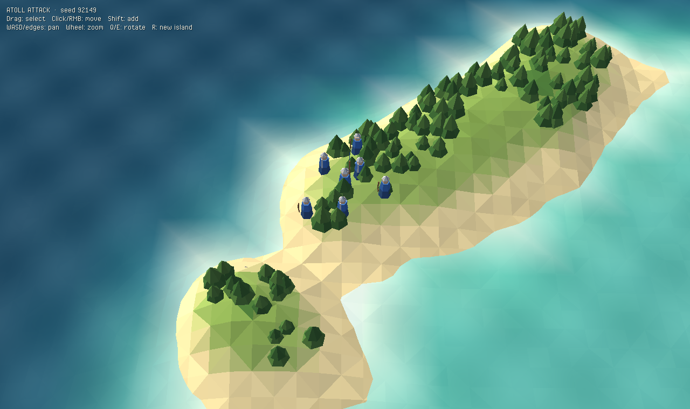

# Atoll Attack — Heaps spike

A Haxe/[Heaps](https://heaps.io) port spike of [atoll-attack](https://github.com/mrisney/atoll-attack): a stylized, low-poly procedural atoll with two squads you can box-select and move.



The goal of this spike is to answer one question: does Heaps give the Northgard-style look and a pleasant dev loop? It covers:

- **Procedural atoll**: a seeded, deterministic heightfield (Int32 hashing, so every platform generates the same island) with a wobbly reef ring broken into islets, a shallow lagoon, and a raised apex where the flag stands.
- **Stylized rendering**: flat-shaded vertex-colored terrain by elevation band, depth-tinted water with an animated HXSL swell and shimmer shader, scattered low-poly pines and rocks, and warm sun with cool ambient lighting.
- **Units**: Captain, Swordsmen, and Archers for blue and red, built from low-poly primitives.
- **RTS controls**: box select, click or right-click to move with formation spreading, shift to add to the selection, slope-aware movement, and units that stop at the shoreline.
- **Camera**: WASD/arrows or edge pan, wheel zoom, and Q/E rotate. On touch, two fingers pan and pinch-zoom.

## Architecture

```
src/
  Main.hx                   app wiring, R = new island
  world/Noise.hx            seeded value noise / fbm (deterministic)
  world/Island.hx           heightfield, heightAt(), walkability, apex
  game/Unit.hx              sim-side unit (no rendering)
  game/Command.hx           Move / Stop — what you'd send over the network
  game/Sim.hx               fixed 30 Hz tick, applies queued commands
  render/Palette.hx         the whole art direction in one file
  render/FlatMeshBuilder.hx low-poly faceted geometry helper
  render/IslandView.hx      terrain, water, props, apex flag
  render/WaterShader.hx     HXSL swell + shimmer
  render/UnitView.hx        unit figures, selection rings, interpolation
  input/RtsCamera.hx        orbit/pan/zoom camera
  input/SelectionController.hx  pointer/touch → selection + Commands
```

The simulation (`world/`, `game/`) never touches rendering or input. Input produces `Command`s, and the `Sim` consumes them on fixed ticks. That is the shape you need for lockstep multiplayer (Steam P2P or WebRTC) and for porting the rules from the Flutter version.

## Setup

1. Install [Haxe 4.3+](https://haxe.org/download/) and [HashLink](https://hashlink.haxe.org/).
2. Install the libraries:
   ```sh
   haxelib install heaps
   haxelib install hlsdl
   ```
   For the latest Heaps instead of the release, run `haxelib git heaps https://github.com/HeapsIO/heaps.git`.

## Run

**Desktop (HashLink):**
```sh
haxe build-hl.hxml
hl bin/game.hl
```

**Web (WebGL):**
```sh
haxe build-js.hxml
npx http-server bin    # or any static server
```
Then open http://localhost:8080.

## Testing on mobile

- **Fastest:** use Chrome DevTools device mode on the web build.
- **Android emulator:** open Chrome in the emulator and go to `http://10.0.2.2:8080`.
- **iOS Simulator:** open Safari and go to `http://localhost:8080`.
- **Real phone on the same Wi-Fi:** the only way to really test pinch and multi-touch.

## Roadmap ideas

- Ships and landings, ported from the Flutter `ShipComponent`
- Port `CombatRules` and add the flag-capture win condition at the apex
- Seasons/weather shader pass, plus shadows (`h3d.pass.DefaultShadowMap`)
- Steamworks via `hlsteam`, with Steam lobbies replacing room codes on PC
- A mobile wrapper (Capacitor) around the WebGL build

## License

MIT
